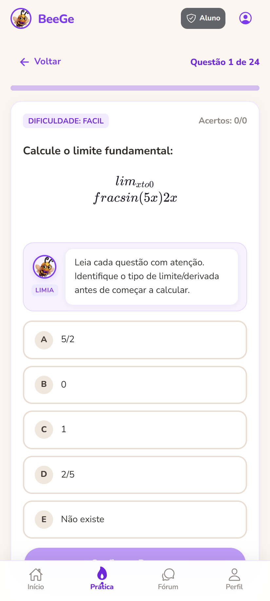

# BeeGe: Plataforma de Revisao de Calculo 1 (Multi-Universidade)

<p align="center">
  
</p>

Aplicativo mobile e web projetado para revisao e pratica de Calculo 1 no ensino superior, com segmentacao de conteudos por universidade e forum academico integrado.

**Repositorio Oficial:** [https://github.com/GabrielSMonteiro/Calculus](https://github.com/GabrielSMonteiro/Calculus)

---

## Video de Apresentacao

Demonstracao pratica do aplicativo BeeGe em execucao:

> 📺 **Acesse a demonstracao em video:** [https://youtu.be/lCUiceX9FIk](https://youtu.be/lCUiceX9FIk)

<p align="center">
  <a href="https://youtu.be/lCUiceX9FIk" target="_blank">
    
  </a>
</p>

---

## Demonstracao Visual do Aplicativo

Registros visuais do aplicativo em execucao:

| Dashboard & Trilhas | Teoria com KaTeX & Limia |
| :---: | :---: |
|  |  |

| Pratica com Resolucao Passo a Passo | Forum Academico |
| :---: | :---: |
|  |  |

| Perfil e Nivel do Estudante | Selecao Multi-Universidade |
| :---: | :---: |
|  |  |

## Visao Geral

O **BeeGe** foi concebido para resolver a dispersao de materiais de Calculo 1, permitindo que estudantes tenham acesso a ementas, resumos teoricos e exercicios ajustados as exigencias de suas proprias instituicoes.

A versao inicial foca na ementa da **Universidade de Brasilia (UnB)**, com arquitetura preparada para expansao multi-institucional (UFMG, USP, entre outras). A mascote do projeto e a abelha **Limia**, que orienta os estudantes com notas conceituais e dicas de resolucao ao longo do aplicativo.

---

## Estrutura do Repositorio

O projeto esta dividido em tres modulos independentes:

| Diretorio | Descricao | Tecnologias |
|---|---|---|
| [`beege-docs/`](./beege-docs) | Documentacao completa de engenharia de software | MkDocs Material, Markdown, Mermaid |
| [`beege-app/`](./beege-app) | Codigo-fonte do aplicativo mobile e interface administrativa | Ionic Framework, React, TypeScript, Capacitor, KaTeX |
| [`beege-api/`](./beege-api) | Infraestrutura de banco de dados, politicas RLS e dados iniciais | Supabase (PostgreSQL), SQL |

---

## Funcionalidades Principais do MVP

- **Autenticacao de Usuarios:** Fluxo de cadastro, login e recuperacao de acesso via Supabase Auth.
- **Filtro Multi-Universidade:** Selecao da instituicao de ensino com adaptacao imediata dos topicos e exercicios.
- **Renderizacao Matematica:** Exibicao precisa de limites, integrais, derivadas e somatorios com suporte nativo a sintaxe LaTeX via KaTeX.
- **Revisao Teorica Estruturada:** Modulos conceituais organizados na sequencia pedagogica adotada pela instituicao.
- **Simulador de Questoes:** Banco de questoes de multipla escolha com correcao imediata e resolucao comentada passo a passo.
- **Forum Academico:** Canal para publicacao de duvidas e respostas com suporte a formulas matematicas e controle de moderacao.
- **Painel Administrativo:** Interface para inclusao de novos modulos teoricos, gestao de exercicios e avaliacao de postagens pendentes.

---

## Tecnologias Utilizadas

- **Frontend:** Ionic Framework com React 19 e TypeScript
- **Camada Mobile:** Capacitor
- **Backend / Banco de Dados:** Supabase (PostgreSQL, Row Level Security, Auth e Storage)
- **Renderizacao de Formulas:** KaTeX
- **Documentacao Tecnica:** MkDocs Material

---

## Instrucoes de Execucao

### 1. Documentacao (`beege-docs`)
```bash
cd beege-docs
pip install mkdocs-material
mkdocs serve
```
O servidor local ficara disponivel em `http://127.0.0.1:8000`.

### 2. Aplicativo (`beege-app`)
```bash
cd beege-app
npm install --legacy-peer-deps
npm run dev
```
O aplicativo estara acessivel em `http://localhost:5173`. O sistema opera tanto conectado a uma instancia ativa do Supabase quanto em modo de demonstracao autônomo local.

Para sincronizacao mobile:
```bash
npm run build
npx cap sync
npx cap open android
```

### 3. Banco de Dados e Migracoes (`beege-api`)
Os scripts SQL para provisionamento das tabelas, politicas de seguranca (RLS) e dados de carga inicial estao localizados em `beege-api/supabase/`.

---

## Documentacao do Projeto

A documentacao detalhada esta disponivel em [`beege-docs/docs`](./beege-docs/docs):
- [Visao do Produto](./beege-docs/docs/visao-produto.md)
- [Canvas do MVP](./beege-docs/docs/canvas-mvp.md)
- [Personas](./beege-docs/docs/personas.md)
- [Requisitos Funcionais e Nao-Funcionais](./beege-docs/docs/requisitos.md)
- [Backlog do Produto](./beege-docs/docs/backlog.md)
- [Documento de Arquitetura](./beege-docs/docs/arquitetura.md)
- [Diagramas UML](./beege-docs/docs/diagramas-uml.md)
- [Cronograma](./beege-docs/docs/cronograma.md)
- [Gestao de Riscos](./beege-docs/docs/riscos.md)
- [Metodologia](./beege-docs/docs/metodologia.md)
- [Plano de Qualidade](./beege-docs/docs/qualidade.md)
- [Guia de Contribuicao](./beege-docs/docs/guia-contribuicao.md)
- [Codigo de Conduta](./beege-docs/docs/codigo-de-conduta.md)

---

## Licenca

Projeto desenvolvido sob os termos da licenca MIT.
