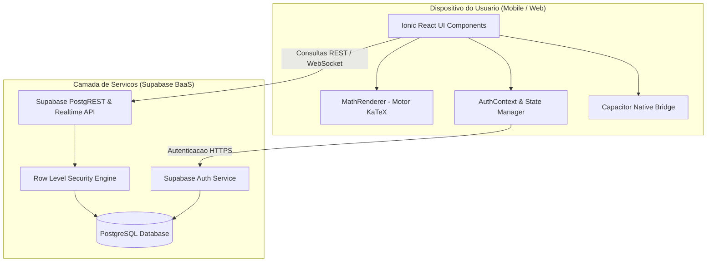

# Documento de Arquitetura de Software: BeeGe

Descricao da organizacao estrutural do sistema, camadas tecnologicas, padroes de projeto e fluxo de dados.

---

## 1. Visao Geral da Arquitetura

O sistema **BeeGe** adota o padrao arquitetural **Cliente-Servidor baseado em BaaS (Backend as a Service)**. Toda a interface de interacao com o usuario opera como uma aplicacao de pagina unica (SPA) multiplataforma que se comunica de maneira assincrona com a infraestrutura gerenciada pelo Supabase.

---

## 2. Camadas do Sistema

### 2.1 Camada Cliente (`beege-app`)
- **Framework de Interface:** React 19 com a biblioteca de componentes graficos do **Ionic Framework**.
- **Controle de Navegacao:** `@ionic/react-router` integrado ao React Router 6 para gestao do historico e transicoes de tela.
- **Renderizacao Matematica:** Componente dedicado `MathRenderer` que encapsula o motor **KaTeX**, convertendo expressoes inline (`$..$`) e em bloco (`$$..$$`) em elementos HTML otimizados.
- **Gerenciamento de Estado:** Context API (`AuthContext`) para manter a sessao do usuario autenticado e a universidade ativa em toda a arvore de componentes.
- **Empacotamento Mobile:** **Capacitor**, responsavel por fornecer a ponte nativa para compilacao em Android (APK) e iOS (IPA) a partir da mesma base web.

### 2.2 Camada de Servicos e Backend (`beege-api`)
- **Autenticacao:** Supabase Auth com suporte a tokens JWT e controle de sessao.
- **Persistencia Relacional:** PostgreSQL 15 com suporte a extensoes como `uuid-ossp`.
- **Politicas de Seguranca (RLS):** Regras granulares por linha que restringem a visualizacao de postagens pendentes e a edicao de modulos exclusivamente para administradores.
- **Carga e Versionamento:** Migracoes SQL versionadas em arquivos timestamped para garantia de reproducibilidade.

---

## 3. Diagrama de Arquitetura e Fluxo de Dados

---

## 4. Padroes de Projeto Utilizados

- **Component-Based Architecture:** Modularizacao da interface em componentes funcionais reutilizaveis com React Hooks.
- **Service Layer Pattern:** Centralizacao de requisicoes de dados e operacoes do Supabase na camada `DataService`, permitindo alternancia transparente entre o backend em nuvem e a camada de dados local.
- **Observer Pattern:** Utilizado pelo Supabase Auth (`onAuthStateChange`) para reatividade imediata do estado de login e perfil.
