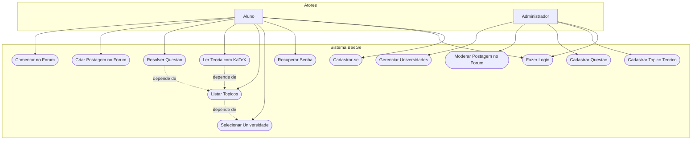
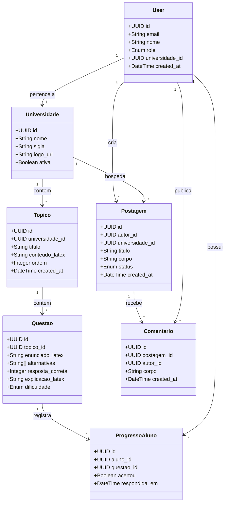
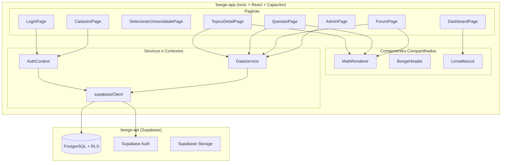
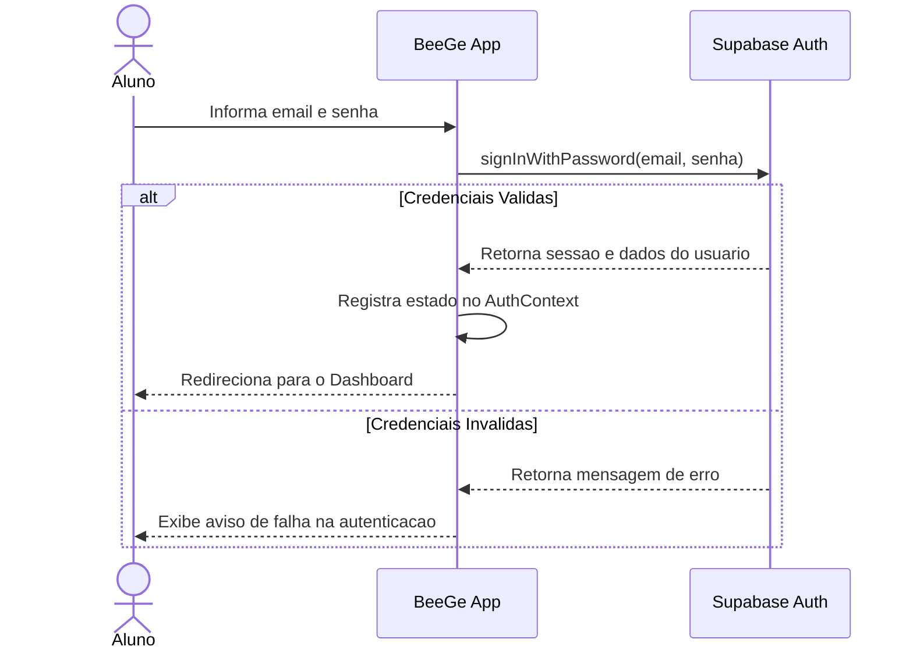
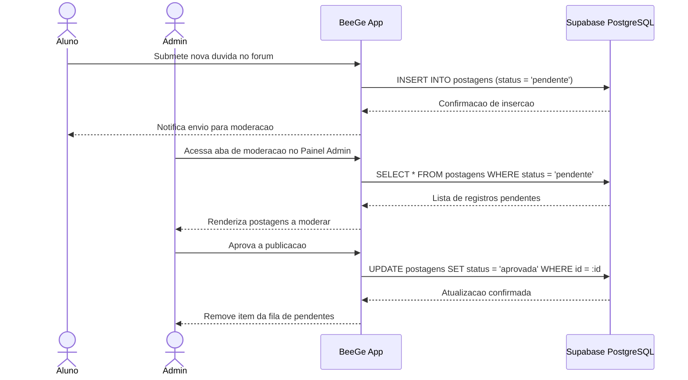

# Diagramas UML: BeeGe

Modelagem visual dos casos de uso, classes do dominio, componentes da arquitetura e fluxos de interacao do sistema.

---

## 1. Diagrama de Casos de Uso

---

## 2. Diagrama de Classes de Dominio

---

## 3. Diagrama de Componentes

---

## 4. Diagrama de Sequencia: Autenticacao de Usuario

---

## 5. Diagrama de Sequencia: Moderacao de Postagens no Forum

